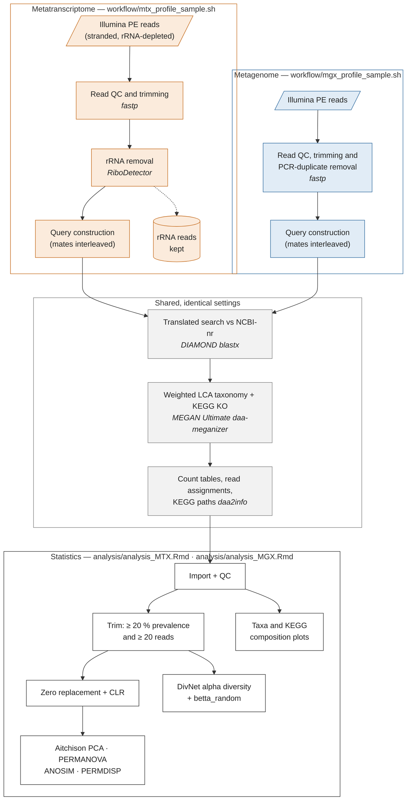
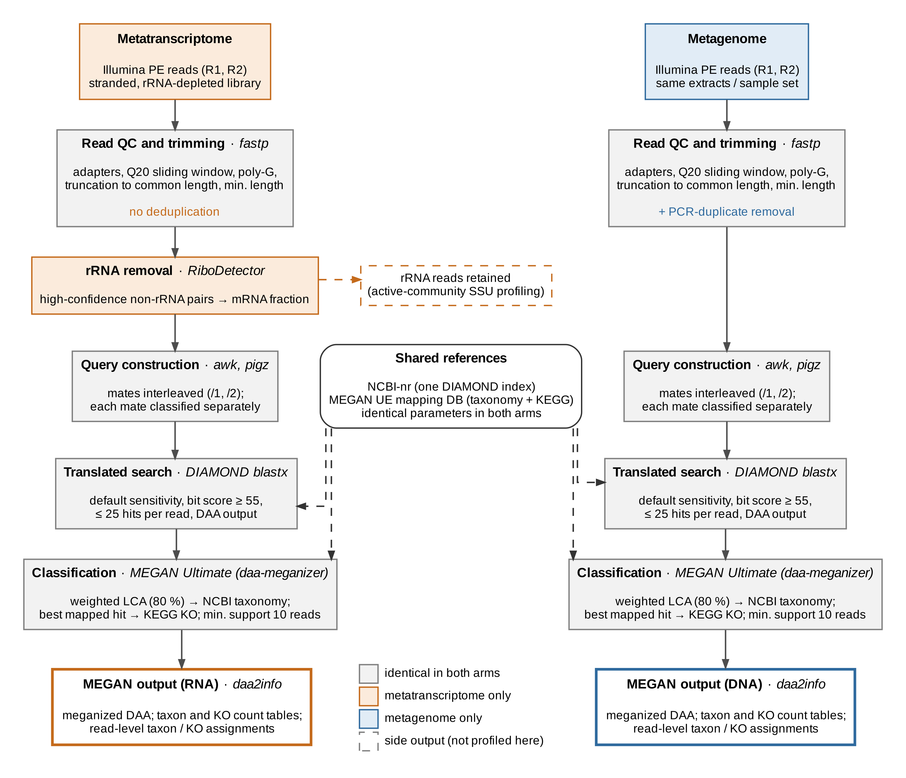

<!--
  DOI BADGE: replace ADDNUMBER (twice) with the numeric GitHub repository ID.
  Find it with:  gh api repos/rgtaketani/MMEG_metaOmics_pipeline --jq .id
  (or on https://zenodo.org/account/settings/github/ after enabling the repo).
  The badge starts working after the first GitHub release has been archived.
  Note: Zenodo archives PUBLIC repositories only.
-->
<p align="center">
  <a href="https://www.rothamsted.ac.uk">
    
  </a>
</p>

# Read-based profiling of soil metatranscriptomes and metagenomes

**Rodrigo G Taketani, David Hughes, Ian M Clark, Tim H Mauchline**
Rothamsted Research *December, 2026*

[](https://zenodo.org/badge/latestdoi/24534916)
[](LICENSE)

Taxonomic and functional (KEGG) profiling of Illumina soil
metatranscriptomes and metagenomes **without assembly**, using
[DIAMOND](https://github.com/bbuchfink/diamond) and
[MEGAN Ultimate](https://software-ab.cs.uni-tuebingen.de/download/megan7/welcome.html),
followed by compositional statistical analysis in R.

The repository has two parts:

1. **Per-sample pipelines** ([`workflow/`](workflow/)): one Bash script for
   metatranscriptomes and one for metagenomes. Each takes the two read files
   of a sample and runs QC, homology search and MEGAN classification. All
   parameters that affect comparability (read length, search and
   classification settings, reference databases) are identical in both
   scripts, so RNA and DNA profiles can be compared directly.
2. **Statistical analyses** ([`analysis/`](analysis/)): one R Markdown
   report per data type. Each report trims low-abundance features, applies
   CLR normalisation, runs Aitchison PCA with PERMANOVA, ANOSIM and PERMDISP,
   plots taxonomic and functional composition, and estimates alpha diversity
   with DivNet.

A methods description with references, ready to adapt for a manuscript, is
in [`docs/methods.md`](docs/methods.md).

## Workflow



The figure for the pipeline part (up to the MEGAN output) is available as
[SVG](docs/figures/workflow.svg), [PDF](docs/figures/workflow.pdf) and
[PNG](docs/figures/workflow.png); its Graphviz source is
[`workflow.dot`](docs/figures/workflow.dot).



## Repository structure

| Path | Content |
|---|---|
| [`workflow/mtx_profile_sample.sh`](workflow/mtx_profile_sample.sh) | Per-sample pipeline for **metatranscriptomes** |
| [`workflow/mgx_profile_sample.sh`](workflow/mgx_profile_sample.sh) | Per-sample pipeline for **metagenomes** |
| [`analysis/analysis_MTX.Rmd`](analysis/analysis_MTX.Rmd) | Statistical analysis of metatranscriptome profiles |
| [`analysis/analysis_MGX.Rmd`](analysis/analysis_MGX.Rmd) | Statistical analysis of metagenome profiles |
| [`config/`](config/) | [Sample metadata template](config/metadata_template.csv) and [description](config/README.md) |
| [`envs/`](envs/) | [Conda environment](envs/pipeline.yml) for the pipeline; [R package installer](envs/install_R_packages.R) for the analyses |
| [`docs/methods.md`](docs/methods.md) | Methods text with references ([Word version](docs/methods.docx)) |
| [`docs/figures/`](docs/figures/) | Workflow figure (SVG, PDF, PNG, Graphviz source) |
| [`docs/analysis_MTX_code.pdf`](docs/analysis_MTX_code.pdf), [`docs/analysis_MGX_code.pdf`](docs/analysis_MGX_code.pdf) | Annotated code of both analyses as PDF (no data, no plots) |
| [`test/`](test/) | Simulated data generator, pipeline smoke test and analysis test ([description](test/README.md)) |
| [`CITATION.cff`](CITATION.cff), [`.zenodo.json`](.zenodo.json) | Citation metadata for GitHub and Zenodo |
| [`.gitattributes`](.gitattributes), [`.gitignore`](.gitignore) | Line endings for scripts (LF, also from Windows) and files excluded from git |
| [`CHANGELOG.md`](CHANGELOG.md), [`LICENSE`](LICENSE) | Version history and licence (CC BY 4.0) |

## Requirements

### Software

* **Pipeline:** `bash` ≥ 4.4, `fastp`, `ribodetector` (metatranscriptomes
  only), `seqkit`, `pigz` and `diamond` ≥ 2.1. All are in
  [`envs/pipeline.yml`](envs/pipeline.yml):
  `mamba env create -f envs/pipeline.yml`.
* **MEGAN Ultimate Edition** (licensed; required for KEGG). Its
  `daa-meganizer` and `daa2info` tools must be on `PATH`, for example by adding
  `<MEGAN install dir>/tools` to `PATH`. Set the Java heap size (`-Xmx`) in
  `MEGAN.vmoptions` to suit your samples.
* **Analysis:** R ≥ 4.2 and the packages installed by
  [`envs/install_R_packages.R`](envs/install_R_packages.R): vegan,
  zCompositions, phyloseq, DivNet, breakaway and others. Rendering to PDF also
  needs LaTeX with `xelatex`.

### Reference databases

Both pipelines must use the **same** two databases:

| Variable | Database |
|---|---|
| `DIAMOND_DB` | DIAMOND index of NCBI-nr (`diamond makedb --in nr.gz -d nr`) |
| `MEGAN_MAPDB` | MEGAN Ultimate mapping database (an `-ue` file; only these carry KEGG) |
| `MEGAN_SYN2TAXA` | *Optional* SILVA synonyms file. It has no effect on searches against nr. |

> **Match the nr release to the mapping file.** Proteins added to nr after
> the mapping file was built have no taxonomy or KEGG mapping, so reads whose
> best hits are recent proteins end up less specifically assigned or
> unassigned. Record both versions; the scripts write them to
> `<sample>.software_versions.txt`.

## Quick start

```bash
# 0. Environment and databases (set once)
conda activate soil-mtx-mgx
export PATH=/path/to/megan/tools:$PATH
export DIAMOND_DB=/refs/nr.dmnd
export MEGAN_MAPDB=/refs/megan-map-Feb2022-ue.db
export THREADS=32                 # default: all cores

# 1. One sample per call; outputs go to $OUTDIR/<sample>_MTX/ or _MGX/
export OUTDIR=megan_output
bash workflow/mtx_profile_sample.sh reads/Plot01_S1_R1_001.fastq.gz reads/Plot01_S1_R2_001.fastq.gz
bash workflow/mgx_profile_sample.sh dna/Plot01_S1_R1_001.fastq.gz  dna/Plot01_S1_R2_001.fastq.gz

# Many samples: loop or submit one job per sample with your scheduler
for r1 in reads/*_R1_001.fastq.gz; do
    bash workflow/mtx_profile_sample.sh "$r1" "${r1/_R1_/_R2_}"
done

# 2. Metadata: one row per sample (see config/metadata_template.csv)

# 3. Statistical analysis (paths are relative to analysis/)
Rscript -e 'rmarkdown::render("analysis/analysis_MTX.Rmd",
             params = list(input_dir = "../megan_output", metadata = "../metadata.csv"))'
```

The only arguments to each pipeline script are the two read files. The sample
name comes from the R1 file name (`Plot01_S1_R1_001.fastq.gz` → `Plot01_S1`).
An interrupted run resumes at the first unfinished step. The header of each
script lists the optional environment variables (`OUTDIR`, `THREADS`,
`DIAMOND_BLOCK`, `DIAMOND_CHUNKS`, …).

## Pipeline outputs (per sample)

| File | Content |
|---|---|
| `<sample>.daa` | DIAMOND alignments with MEGAN classifications (opens in MEGAN) |
| `<sample>.Taxonomy.counts.tsv`, `<sample>.KEGG.counts.tsv` | Reads per taxon and per KO |
| `<sample>.Taxonomy.paths.counts.tsv` | Reads per lineage at major ranks (input to the R analysis) |
| `<sample>.KEGG.paths.counts.tsv` | KEGG hierarchy path of every KO (a KO in several pathways is listed once per pathway; for the hierarchy only, do not sum) |
| `<sample>.Taxonomy.read2class.tsv.gz`, `<sample>.KEGG.read2class.tsv.gz` | Read-level assignments, for taxon × function tables |
| `<sample>.read_counts.tsv` | Reads at each stage (SeqKit) |
| `<sample>.fastp.html` / `.json` | fastp QC report |
| `<sample>.rrna_R{1,2}.fq.gz`, `<sample>.mrna_R{1,2}.fq.gz` | rRNA and mRNA fractions (metatranscriptomes only) |
| `<sample>.qc_R{1,2}.fq.gz` | Trimmed and deduplicated reads (metagenomes only) |
| `<sample>.software_versions.txt`, `<sample>.pipeline.log` | Versions, databases, parameters and the shared-parameter fingerprint |

## Design notes

* **Harmonised arms.** The block headed `SHARED PARAMETERS` must be identical
  in both scripts. Each run logs a *fingerprint* (a hash of the shared
  parameters and database names), and RNA and DNA runs of one project must
  report the same value. [`test/run_pipeline_smoke_test.sh`](test/run_pipeline_smoke_test.sh)
  checks this.
* **Shared parameters**, set to the values of the group's established
  DIAMOND + MEGAN workflow:

  | Setting | Value |
  |---|---|
  | Read truncation / minimum length / 3′ quality | 150 nt / 75 nt / Q20 |
  | DIAMOND blastx | default sensitivity, bit score ≥ 55, ≤ 25 hits per read |
  | MEGAN LCA | weighted, 80% coverage, top 10%, bit score ≥ 55, e-value ≤ 0.01 |
  | MEGAN minimum support | 10 reads (taxa below this are merged into their parent) |

* **Mates are classified independently.** `daa-meganizer` has no paired-read
  mode, so counts are per read, not per fragment. Both arms are affected in
  the same way, so RNA/DNA comparisons are not biased by this.
* **Arm-specific steps.** Metatranscriptomes are not deduplicated (identical
  reads mostly reflect expression) and have rRNA removed. Metagenomes are
  deduplicated.
* **Statistical design.** Locations are nested within countries. Treatment
  and compartment are tested with permutations within locations, and country
  is tested with whole locations as replicates. In the DivNet models,
  location is a random effect. See Section 8.1 of either analysis.

## Testing

```bash
bash test/run_pipeline_smoke_test.sh   # seconds; no databases or MEGAN needed
bash test/run_analysis_test.sh         # minutes; renders both Rmds on simulated data
```

See [`test/README.md`](test/README.md) for the simulated design.

## Citation

If you use this workflow, please cite the archived release using the Zenodo DOI in the badge at the top of
this page (details in [`CITATION.cff`](CITATION.cff)). Also
cite the tools it relies on; the full list with references is in
[`docs/methods.md`](docs/methods.md#references).

## Licence

This repository is licensed under the
[Creative Commons Attribution 4.0 International licence (CC BY 4.0)](LICENSE).
MEGAN Ultimate Edition, NCBI-nr and KEGG are subject to their own licences
and terms of use.
