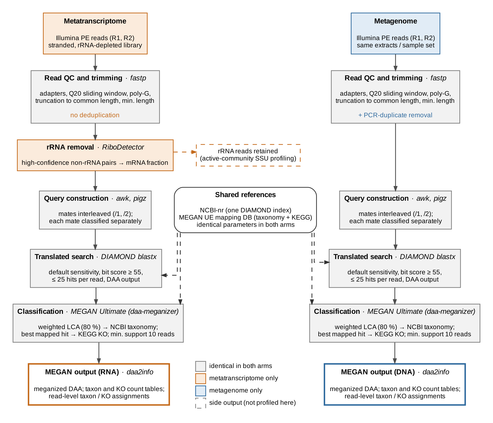

[← Back to the main README](../README.md)

This text describes the workflow in this repository in a form that can be
adapted for a manuscript. Values in square brackets are placeholders, to be
completed from each run's `*.software_versions.txt` and `*.pipeline.log` and
from the R session information at the end of each analysis report. The
implementation is in [`workflow/`](../workflow/) (pipeline) and
[`analysis/`](../analysis/) (statistics). A Word version is available as
[`methods.docx`](methods.docx).

## Methods

**Read pre-processing.** Paired-end Illumina reads from metatranscriptomes and metagenomes were processed per sample with two shell pipelines that share all reference databases and parameters controlling query length, homology search and classification (Figure 1). Adapters, poly-G tails and low-quality 3′ ends (sliding-window mean Q < 20) were removed with fastp v[x.y.z] (Chen et al., 2018); reads were truncated to [150] nt and pairs with a read shorter than 75 nt were discarded. PCR duplicates were removed from metagenomic libraries only, as identical reads in metatranscriptomes largely reflect transcript abundance. In metatranscriptomes, rRNA reads were then separated from putative mRNA with RiboDetector v[x.y.z] (Deng et al., 2022), assigning ambiguous pairs to the rRNA fraction (`-e norrna`); the rRNA fraction was retained for community profiling and as a depletion quality metric.

**Homology search and classification.** Both mates of each pair were searched individually against the NCBI non-redundant protein database (nr; downloaded [date]; Sayers et al., 2025) with DIAMOND blastx v[x.y.z] in default sensitivity mode, reporting up to 25 hits per read with a minimum bit score of 55 (Buchfink et al., 2021). Alignments were classified with `daa-meganizer` from MEGAN Ultimate Edition v[x.y.z] (Huson et al., 2016; Bağcı et al., 2021) using the mapping database megan-map-Feb2022-ue. Each mate was classified independently. Taxonomy was assigned with the weighted lowest-common-ancestor algorithm (80% coverage) after filtering hits by minimum bit score (55), maximum e-value (0.01) and top percent (10). Taxa supported by fewer than 10 reads were merged into their parent taxon. KEGG Orthology (KO) groups (Kanehisa & Goto, 2000) were assigned from the best-scoring hit carrying a KEGG mapping. Per-sample taxon and KO count tables, read-level assignments and the KEGG hierarchy paths of each KO were exported with `daa2info`. SeqKit v[x.y.z] (Shen et al., 2016) was used to summarise read counts at each stage.

**Statistical analysis.** Analyses were run in R v[x.y.z] separately for metatranscriptomes and metagenomes, and separately for taxa (aggregated at genus level) and KOs. Features detected in fewer than 20% of samples or with fewer than 20 reads in total were removed. Zeros were replaced with the geometric Bayesian-multiplicative method (Martín-Fernández et al., 2015) implemented in zCompositions (Palarea-Albaladejo & Martín-Fernández, 2015), and counts were centred log-ratio (CLR) transformed (Gloor et al., 2017). Community composition was ordinated by principal component analysis of CLR values, equivalent to an ordination on Aitchison distances. Effects on composition were tested with PERMANOVA on Aitchison distances (vegan `adonis2`; Anderson, 2001; Oksanen et al., [year]). Treatment and compartment effects were tested with permutations restricted within locations. The country effect was tested by permuting whole locations between countries, so that locations were the replicates for country. Pairwise treatment comparisons were adjusted with the Benjamini–Hochberg procedure. Group differences were also assessed with ANOSIM (Clarke, 1993), and homogeneity of multivariate dispersion was tested with PERMDISP (`betadisper`; Anderson, 2006). Shannon and Simpson diversity were estimated per sample with DivNet (Willis & Martin, 2022) and compared with `betta_random` (breakaway; Willis et al., 2017), with country, compartment, treatment and the compartment × treatment interaction as fixed effects and location as a random effect. Model terms were tested with Wald χ² tests. Treatments were compared within each compartment using model-based marginal means, with Benjamini–Hochberg adjustment.

**Code availability.** The pipeline scripts, analysis code and test data generator are available at [GitHub URL] and archived on Zenodo ([DOI]).

**Figure 1.** Workflow for read-based profiling of soil metatranscriptomes (left) and metagenomes (right). Grey steps use identical code and parameters in both arms; orange elements are specific to metatranscriptomes, and blue text marks the metagenome-only duplicate removal. The dashed box is a side output retained for downstream analyses. Both arms use the same DIAMOND index of NCBI-nr and MEGAN Ultimate mapping database, so RNA and DNA profiles are directly comparable.

## References

Anderson, M. J. (2001). A new method for non-parametric multivariate analysis of variance. *Austral Ecology*, 26, 32–46. <https://doi.org/10.1111/j.1442-9993.2001.01070.pp.x>

Anderson, M. J. (2006). Distance-based tests for homogeneity of multivariate dispersions. *Biometrics*, 62, 245–253. <https://doi.org/10.1111/j.1541-0420.2005.00440.x>

Bağcı, C., Patz, S., & Huson, D. H. (2021). DIAMOND+MEGAN: Fast and easy taxonomic and functional analysis of short and long microbiome sequences. *Current Protocols*, 1, e59. <https://doi.org/10.1002/cpz1.59>

Buchfink, B., Reuter, K., & Drost, H.-G. (2021). Sensitive protein alignments at tree-of-life scale using DIAMOND. *Nature Methods*, 18, 366–368. <https://doi.org/10.1038/s41592-021-01101-x> — software: <https://github.com/bbuchfink/diamond>

Chen, S., Zhou, Y., Chen, Y., & Gu, J. (2018). fastp: an ultra-fast all-in-one FASTQ preprocessor. *Bioinformatics*, 34, i884–i890. <https://doi.org/10.1093/bioinformatics/bty560> — software: <https://github.com/OpenGene/fastp>

Clarke, K. R. (1993). Non-parametric multivariate analyses of changes in community structure. *Australian Journal of Ecology*, 18, 117–143. <https://doi.org/10.1111/j.1442-9993.1993.tb00438.x>

Deng, Z.-L., Münch, P. C., Mreches, R., & McHardy, A. C. (2022). Rapid and accurate identification of ribosomal RNA sequences via deep learning. *Nucleic Acids Research*, 50, e60. <https://doi.org/10.1093/nar/gkac112> — software: <https://github.com/hzi-bifo/RiboDetector>

Gloor, G. B., Macklaim, J. M., Pawlowsky-Glahn, V., & Egozcue, J. J. (2017). Microbiome datasets are compositional: and this is not optional. *Frontiers in Microbiology*, 8, 2224. <https://doi.org/10.3389/fmicb.2017.02224>

Huson, D. H., Beier, S., Flade, I., et al. (2016). MEGAN Community Edition — interactive exploration and analysis of large-scale microbiome sequencing data. *PLoS Computational Biology*, 12, e1004957. <https://doi.org/10.1371/journal.pcbi.1004957> — software and mapping databases: <https://software-ab.cs.uni-tuebingen.de/download/megan7/welcome.html>

Kanehisa, M., & Goto, S. (2000). KEGG: Kyoto Encyclopedia of Genes and Genomes. *Nucleic Acids Research*, 28, 27–30. <https://doi.org/10.1093/nar/28.1.27> — database: <https://www.kegg.jp/>

Martín-Fernández, J. A., Hron, K., Templ, M., Filzmoser, P., & Palarea-Albaladejo, J. (2015). Bayesian-multiplicative treatment of count zeros in compositional data sets. *Statistical Modelling*, 15, 134–158. <https://doi.org/10.1177/1471082X14535524>

Oksanen, J., Simpson, G. L., Blanchet, F. G., et al. ([year]). vegan: Community Ecology Package, R package version [x.y-z]. <https://CRAN.R-project.org/package=vegan>

Palarea-Albaladejo, J., & Martín-Fernández, J. A. (2015). zCompositions — R package for multivariate imputation of left-censored data under a compositional approach. *Chemometrics and Intelligent Laboratory Systems*, 143, 85–96. <https://doi.org/10.1016/j.chemolab.2015.02.019>

Sayers, E. W., Beck, J., Bolton, E. E., et al. (2025). Database resources of the National Center for Biotechnology Information in 2025. *Nucleic Acids Research*, 53, D20–D29. <https://doi.org/10.1093/nar/gkae979> — NCBI-nr: <https://ftp.ncbi.nlm.nih.gov/blast/db/FASTA/>

Shen, W., Le, S., Li, Y., & Hu, F. (2016). SeqKit: a cross-platform and ultrafast toolkit for FASTA/Q file manipulation. *PLoS ONE*, 11, e0163962. <https://doi.org/10.1371/journal.pone.0163962> — software: <https://github.com/shenwei356/seqkit>

Willis, A., Bunge, J., & Whitman, T. (2017). Improved detection of changes in species richness in high diversity microbial communities. *Journal of the Royal Statistical Society Series C*, 66, 963–977. <https://doi.org/10.1111/rssc.12206> — software (breakaway): <https://github.com/adw96/breakaway>

Willis, A. D., & Martin, B. D. (2022). Estimating diversity in networked ecological communities. *Biostatistics*, 23, 207–222. <https://doi.org/10.1093/biostatistics/kxaa015> — software (DivNet): <https://github.com/adw96/DivNet>

Additional software without a formal citation: pigz (parallel gzip), <https://zlib.net/pigz/>.
